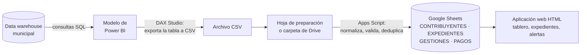
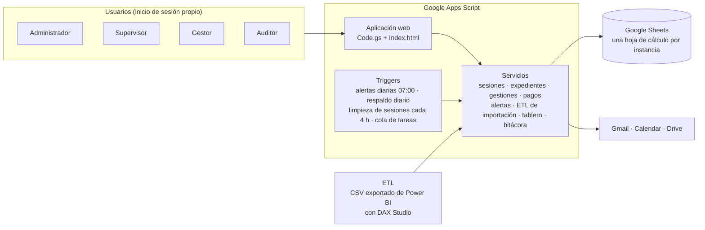
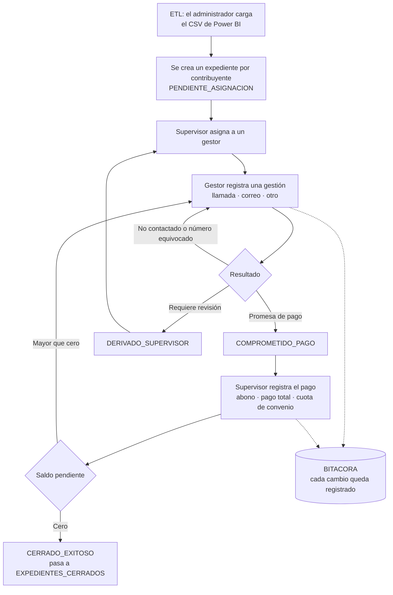
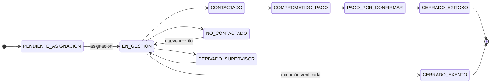
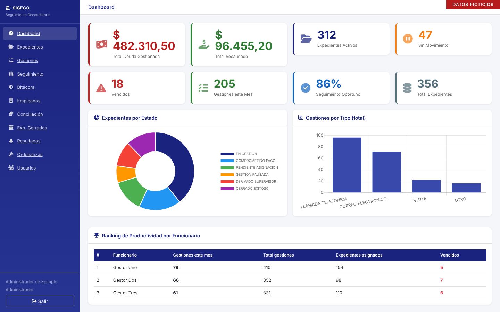
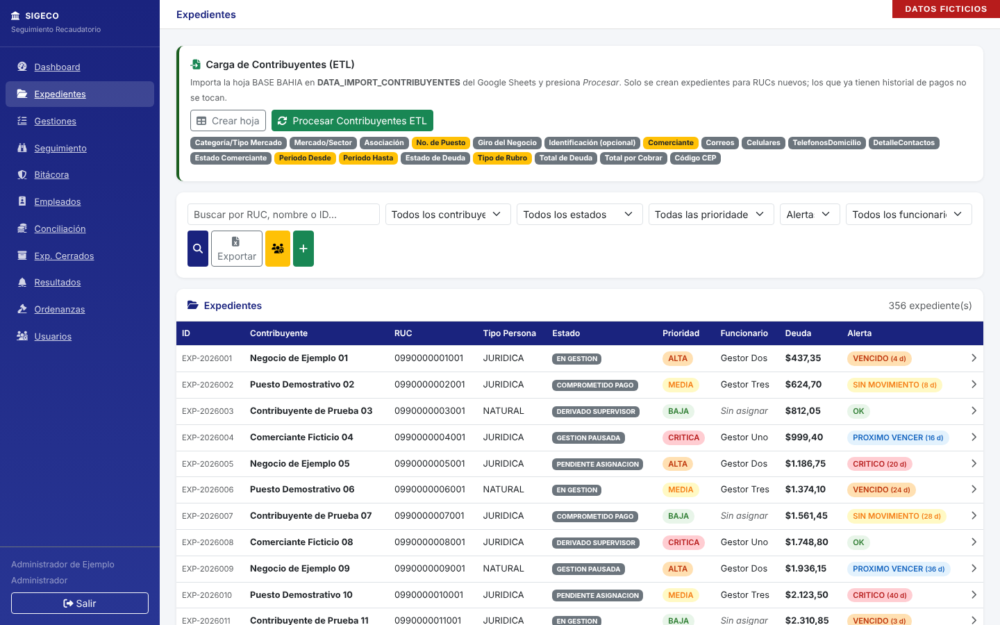

# SIGECO: Sistema Integral de Gestión de Cobranza

ETL y aplicación web para la cobranza municipal. Toma la deuda desde Power BI, la procesa en Google Apps Script, la guarda en Google Sheets y la entrega en una aplicación web (HTML) para gestionar expedientes, gestiones, pagos, alertas y bitácora de auditoría.

| | |
|---|---|
| **Responsable** | Jorge Jamil Espinoza Villa, Analista Financiero |
| **Área** | Dirección General Financiera, M.I. Municipalidad de Guayaquil |
| **Estado** | En operación, dos instancias |
| **Plataforma** | Google Apps Script (V8) y Google Sheets |
| **Uso** | Interno. Repositorio privado |

## Contenido

[Qué hace](#qué-hace) · [Flujo de datos (ETL)](#flujo-de-datos-etl) · [Arquitectura](#arquitectura) · [Flujo de trabajo](#flujo-de-trabajo) · [Ciclo de vida del expediente](#ciclo-de-vida-del-expediente) · [Alertas](#alertas) · [Roles y permisos](#roles-y-permisos) · [Instancias](#instancias) · [Estructura](#estructura-del-repositorio) · [Pantallas](#pantallas) · [Ejemplo](#ejemplo-con-datos-ficticios) · [Consultas SQL](#consultas-sql) · [Documentación](#documentación) · [Relacionados](#repositorios-relacionados) · [Seguridad](#datos-y-seguridad)

## Qué hace

- **ETL:** recibe el CSV exportado de Power BI, normaliza y valida las columnas, y carga los contribuyentes con deuda en Google Sheets.
- Crea un expediente por contribuyente y lo asigna a un gestor.
- Registra cada gestión de cobro (llamada telefónica, correo electrónico y otros) con su resultado y próxima fecha.
- Registra pagos y calcula saldo pendiente y porcentaje recuperado.
- Genera alertas por días sin movimiento y por gestiones vencidas, con aviso por correo.
- Cierra expedientes y los archiva con motivo y responsable.
- Deja una bitácora de auditoría de cada cambio.
- Entrega un tablero de indicadores y respaldos diarios.

## Flujo de datos (ETL)

SIGECO es un ETL completo: **extrae** la deuda del modelo de Power BI, la **transforma** y valida con Apps Script, la **carga** en Google Sheets y la **presenta** en una aplicación web.



| Etapa | Qué ocurre | Dónde |
|---|---|---|
| Extracción | Las consultas SQL arman el modelo de Power BI. El analista exporta la tabla con **DAX Studio** a un archivo CSV | [`consultas/`](consultas/README.md) |
| Carga a preparación | El CSV entra a una hoja de preparación (*staging*) de la misma hoja de cálculo | Hojas `DATA_*` |
| Transformación | Apps Script normaliza los encabezados, valida cada fila, descarta duplicados y crea un expediente por contribuyente nuevo | `ImportService.gs`, `DataManagementService.gs` |
| Carga final | Los datos quedan en `CONTRIBUYENTES` y `EXPEDIENTES`. Los pagos se registran en `PAGOS` | Google Sheets |
| Presentación | La aplicación web lee las hojas y muestra tablero, expedientes y alertas | `Code.gs`, `Index.html` |

**Pagos (ambas instancias):** se pega la tabla de pagos en la hoja `DATA_POWERBI_IMPORT_PAGOS` y un botón de ETL registra cada pago en el expediente activo del RUC. También hay conciliación desde otra hoja con vista previa y confirmación.

Cada instancia carga los contribuyentes de forma distinta:

| | Bahías | Patente Municipal |
|---|---|---|
| Entrada | Se pega la tabla en la hoja de preparación `DATA_IMPORT_CONTRIBUYENTES` | Se sube el CSV a la carpeta `SIGECO_ETL/IMPORTS` de Drive, o se pega en `DATA_POWERBI_IMPORT_CONTRIBUYENTES` |
| Proceso | **Vista previa** con filas aceptadas, duplicadas y rechazadas; el administrador confirma | Un disparador diario (6:00) procesa los CSV nuevos; también hay un botón «Procesar Contribuyentes ETL» |
| Controles | Suma de verificación (*checksum*), bloqueo contra importaciones simultáneas, **respaldo previo** de la hoja, reporte en `IMPORT_REPORTE` | El CSV procesado se mueve a `SIGECO_ETL/PROCESSED` con fecha y hora; no duplica expedientes de RUC existentes |
| Clave de la obligación | RUC + tipo de impuesto + puesto + periodo desde y hasta | Un expediente activo por RUC, con los impuestos y años de solicitud agrupados |
| Después de cargar | Asigna los expedientes automáticamente | Crea el expediente y lo asigna por turnos entre los gestores activos |

## Arquitectura



## Flujo de trabajo



En Patente Municipal la asignación inicial es automática: el ETL reparte los expedientes nuevos por turnos entre los gestores activos.

## Ciclo de vida del expediente

Estados definidos en `Constants.gs`. El flujo habitual es el siguiente; el sistema no impone un orden fijo entre estados.



La instancia de Patente Municipal agrega los estados `GESTION_PAUSADA`, `CERRADO_SIN_ACUERDO` y `DERIVADO_TITULO`.

## Alertas

Cada expediente lleva un estado de alerta que se recalcula todos los días a las 7:00 y alimenta la hoja `SEGUIMIENTO`.

| Alerta | Parámetro en `Constants.gs` | Valor |
|---|---|---|
| `OK` | | |
| `SIN_MOVIMIENTO` | `DIAS_ALERTA_SIN_MOVIMIENTO` | 15 días sin gestión |
| `PROXIMO_VENCER` | `DIAS_ALERTA_PROXIMO_VENCER` | 3 |
| `VENCIDO` | `DIAS_ALERTA_VENCIDO` | 0 |
| `CRITICO` | `DIAS_ALERTA_CRITICO` | 30 |

Los valores se ajustan en la hoja `CONFIG` sin tocar el código. Las alertas `VENCIDO` y `CRITICO` pueden enviarse por correo.

## Roles y permisos

Cuatro roles jerárquicos. Cada acción exige un nivel mínimo, tomado de `PERMISOS` en `Constants.gs`.

| Acción | Administrador | Supervisor | Gestor | Auditor |
|---|:-:|:-:|:-:|:-:|
| Ver todos los expedientes | ✔ | ✔ | – | – |
| Ver sus propios expedientes | ✔ | ✔ | ✔ | – |
| Crear expediente | ✔ | ✔ | ✔ | – |
| Actualizar expediente | ✔ | ✔ | ✔ | – |
| Marcar cierre exitoso | ✔ | ✔ | ✔ | – |
| Reasignar expediente | ✔ | ✔ | – | – |
| Cerrar expediente | ✔ | ✔ | – | – |
| Cerrar por exención | ✔ | ✔ | – | – |
| Ver expedientes cerrados | ✔ | ✔ | – | – |
| Reabrir expediente | ✔ | ✔ | – | – |
| Registrar gestión | ✔ | ✔ | ✔ | – |
| Ver seguimiento y alertas | ✔ | ✔ | – | – |
| Ver bitácora de auditoría | ✔ | ✔ | ✔ | ✔ |
| Ver tablero de indicadores | ✔ | ✔ | ✔ | – |
| Importar contribuyentes | ✔ | – | – | – |
| Gestionar usuarios | ✔ | – | – | – |
| Modificar configuración | ✔ | – | – | – |
| Registrar pago | ✔ | ✔ | – | – |
| Verificar integridad de datos | ✔ | – | – | – |
| Insertar datos de prueba | ✔ | – | – | – |

La sesión dura 8 horas, el inicio de sesión se bloquea 15 minutos tras 5 intentos fallidos y solo se aceptan correos del dominio institucional.

## Instancias

Un mismo sistema desplegado para dos líneas de cobro. Cada instancia tiene su propia hoja de cálculo y su propio proyecto de Apps Script.

| Instancia | Carpeta | Particularidades |
|---|---|---|
| Bahías | [`apps-script/bahias/`](apps-script/bahias/) | Datos del puesto comercial: mercado, asociación, giro del negocio, código CEP; importación con vista previa, respaldo previo y reporte |
| Patente Municipal | [`apps-script/patente-municipal/`](apps-script/patente-municipal/) | Deuda por año e impuesto; carga por CSV desde Drive con disparador diario; ETL de pagos; claves en propiedades del script; estados adicionales |

## Estructura del repositorio

```
.
├── apps-script/
│   ├── bahias/                     proyecto Apps Script de la instancia Bahías
│   │   ├── Code.gs                 punto de entrada de la aplicación web
│   │   ├── Index.html              interfaz
│   │   ├── Constants.gs            catálogos, roles, permisos y parámetros
│   │   ├── Auth.gs · SecurityService.gs   sesiones y permisos
│   │   ├── Expediente*.gs · GestionService.gs · PagoService.gs   núcleo de cobranza
│   │   ├── AlertService.gs · SeguimientoService.gs   alertas y seguimiento
│   │   ├── ImportService.gs · DriveImportService.gs   carga del padrón
│   │   ├── DashboardService.gs     indicadores
│   │   ├── BitacoraService.gs      auditoría
│   │   ├── BackupService.gs        respaldo diario
│   │   └── Setup.gs                instalación inicial
│   └── patente-municipal/          misma estructura, más SecretsService.gs,
│                                   ExportService.gs y PowerBIService.gs (heredado)
├── consultas/                      consultas SQL de la instancia Patente Municipal
│   ├── README.md
│   ├── detalle-de-contribuyentes-por-anio-de-solicitud_v202610.sql
│   └── pagos-y-reversos-patente-y-1-5-por-mil_v202610.sql
├── docs/
│   ├── modelo-de-datos.md          hojas, columnas y relaciones
│   ├── arquitectura-y-modulos.md   módulos y automatizaciones
│   ├── guia-etl.md                 guía rápida del ETL
│   ├── despliegue.md               instalación paso a paso
│   ├── img/                        capturas con datos ficticios
│   └── pendientes-tecnicos.md      hallazgos y recomendaciones
├── pruebas/                        pruebas automáticas del ETL (Node, sin dependencias)
├── .github/                        verificación automática y plantilla de cambios
├── CHANGELOG.md                    historial de cambios
└── SEGURIDAD.md                    qué nunca se sube
```

## Pantallas

Capturas de la instancia Bahías con datos ficticios (cada una lleva la marca «DATOS FICTICIOS»).

| Inicio de sesión | Tablero |
|---|---|
|  |  |



## Ejemplo con datos ficticios

Un expediente tal como lo ve el sistema. Todos los datos son inventados.

| Campo | Valor de ejemplo |
|---|---|
| `ID_EXPEDIENTE` | `EXP-000123` |
| `RUC` | `0990000000001` |
| `CONTRIBUYENTE` | `COMERCIAL EJEMPLO S.A.` |
| `TIPO_OBLIGACION` | `IMPUESTO_PATENTE` |
| `ESTADO_EXPEDIENTE` | `COMPROMETIDO_PAGO` |
| `PRIORIDAD` | `ALTA` |
| `FUNCIONARIO_ASIGNADO` | `gestor.ejemplo@guayaquil.gob.ec` |
| `TOTAL_DEUDA` | 1.200,00 |
| `MONTO_PAGADO` | 300,00 |
| `SALDO_PENDIENTE` | 900,00 |
| `PORCENTAJE_RECUPERADO` | 25 % |
| `ALERTA_ESTADO` | `PROXIMO_VENCER` |

Gestiones registradas sobre ese expediente:

| Fecha | Tipo | Resultado | Próxima gestión |
|---|---|---|---|
| 2026-01-12 | `LLAMADA_TELEFONICA` | `NO_CONTACTADO` | 2026-01-14 |
| 2026-01-14 | `LLAMADA_TELEFONICA` | `CONTACTO_EFECTIVO` | 2026-01-21 |
| 2026-01-21 | `CORREO_ELECTRONICO` | `PROMESA_PAGO` | 2026-02-04 |

## Consultas SQL

La instancia Patente Municipal se alimenta con 2 consultas al data warehouse municipal: el detalle de contribuyentes por año de solicitud y los pagos y reversos de patente y del 1,5 por mil. Están en [`consultas/`](consultas/README.md) como versiones sanitizadas, sin RUC ni servidor.

## Documentación

| Documento | Contenido |
|---|---|
| [Modelo de datos](docs/modelo-de-datos.md) | Hojas, columnas y relaciones de cada instancia |
| [Arquitectura y módulos](docs/arquitectura-y-modulos.md) | Roles, módulos y automatizaciones |
| [Guía rápida del ETL](docs/guia-etl.md) | Cómo cargar la deuda desde Power BI, paso a paso |
| [Despliegue](docs/despliegue.md) | Instalación paso a paso de una instancia |
| [Pendientes técnicos](docs/pendientes-tecnicos.md) | Hallazgos de la revisión del código y recomendaciones |
| [Seguridad](SEGURIDAD.md) | Qué nunca se sube y qué hacer si ocurre |

## Repositorios relacionados

- [SICOGE](https://github.com/jamil73jev/SICOGE): vista de georreferenciación de la cartera.
- [Dashboards-de-Power-BI](https://github.com/jamil73jev/Dashboards-de-Power-BI): dashboards y consultas del modelo del que se alimenta el ETL de SIGECO.

## Historial de cambios

Ver [`CHANGELOG.md`](CHANGELOG.md). Los cambios se revisan con la lista de la plantilla de pull request y con la verificación automática de `.github/`.

## Datos y seguridad

Este repositorio **no contiene datos de contribuyentes, claves ni respaldos**. Las bases de datos se guardan en el almacenamiento institucional. Las claves se leen de las propiedades del script. Ver [`SEGURIDAD.md`](SEGURIDAD.md).
