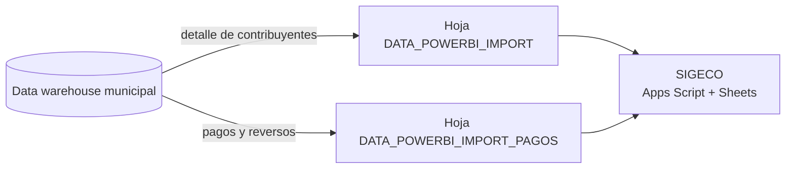

# Consultas SQL de SIGECO

Consultas del data warehouse municipal que alimentan la instancia **Patente Municipal** de SIGECO. Sus resultados se importan a las hojas `DATA_POWERBI_IMPORT` y `DATA_POWERBI_IMPORT_PAGOS` del libro de la instancia.

| Consulta | Qué responde | Página | Granularidad |
|---|---|---|---|
| [`detalle-de-contribuyentes-por-anio-de-solicitud_v202610.sql`](detalle-de-contribuyentes-por-anio-de-solicitud_v202610.sql) | Detalle de contribuyentes por año de solicitud, con correos y teléfonos de gestión consolidados desde varias fuentes. Excluye entidades por lista de RUC y por patrones de nombre de entidades exentas. | DATA_POWERBI_IMPORT | Una fila por contribuyente y año de solicitud |
| [`pagos-y-reversos-patente-y-1-5-por-mil_v202610.sql`](pagos-y-reversos-patente-y-1-5-por-mil_v202610.sql) | Pagos y reversos de patente municipal y del 1,5 por mil: impuesto principal, interés, multa, recargo, coactiva, convenios y valor pagado neto. El valor de convenio es informativo y no se suma otra vez al total pagado. | DATA_POWERBI_IMPORT_PAGOS | Una fila por pago o reverso |

## Marcadores

Estas versiones están **sanitizadas**.

| Marcador | Dónde | Qué poner |
|---|---|---|
| `<RUC_1>` a `<RUC_8>` | `detalle-de-contribuyentes-por-anio-de-solicitud` | RUC de las entidades que se excluyen. La lista real se guarda fuera del repositorio |

## Seguridad

- Las consultas solo contienen lógica. No incluyen datos de contribuyentes ni credenciales.
- Los resultados traen RUC, nombres, correos y teléfonos de contribuyentes. Se quedan en la hoja de la instancia y no se suben a GitHub.
