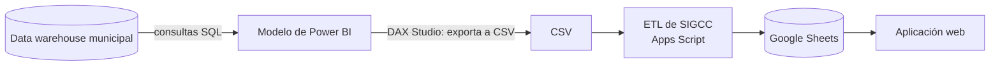

# Consultas SQL de SIGCC

Consultas del data warehouse municipal que arman el modelo de Power BI del que se alimenta la instancia **Patente Municipal** de SIGCC. El analista exporta la tabla con DAX Studio a CSV y el ETL de SIGCC la carga en las hojas de preparación (ver el [flujo de datos](../README.md#flujo-de-datos-etl)).

| Consulta | Qué responde | Página | Granularidad |
|---|---|---|---|
| [`detalle-de-contribuyentes-por-anio-de-solicitud_v202610.sql`](detalle-de-contribuyentes-por-anio-de-solicitud_v202610.sql) | Detalle de contribuyentes por año de solicitud, con correos y teléfonos de gestión consolidados desde varias fuentes. Excluye entidades por lista de RUC y por patrones de nombre de entidades exentas. | DATA_POWERBI_IMPORT | Una fila por contribuyente y año de solicitud |
| [`pagos-y-reversos-patente-y-1-5-por-mil_v202610.sql`](pagos-y-reversos-patente-y-1-5-por-mil_v202610.sql) | Pagos y reversos de patente municipal y del 1,5 por mil: impuesto principal, interés, multa, recargo, coactiva, convenios y valor pagado neto. El valor de convenio es informativo y no se suma otra vez al total pagado. | DATA_POWERBI_IMPORT_PAGOS | Una fila por pago o reverso |

## Marcadores

Estas versiones están **sanitizadas**.

| Marcador | Dónde | Qué poner |
|---|---|---|
| `<RUC_1>` a `<RUC_8>` | `detalle-de-contribuyentes-por-anio-de-solicitud` | RUC de las entidades que se excluyen. La lista real se guarda fuera del repositorio |

## Cómo se relacionan con las hojas del ETL

- **Detalle de contribuyentes:** la consulta devuelve `AnioSolicitud`, `Impuesto`, `Ruc`, `NombreContribuyente`, `TipoPersona`, correos, teléfonos, `RepresentanteLegal` y los valores de impuesto, interés, multa, recargo y pendiente. En Power BI se exportan como `ANIOSOLICITUD`, `IMPUESTO`, `RUC`… `SUMVALORPENDIENTE`, que son las 15 columnas que espera la hoja `DATA_POWERBI_IMPORT_CONTRIBUYENTES`.
- **Pagos y reversos:** la consulta devuelve más columnas (canal de pago, banco, reversos, convenios) que las 5 que lee el ETL de pagos (`RUC`, `MONTO_PAGADO`, `TIPO_PAGO`, `REFERENCIA`, `FECHA_PAGO`). Antes de cargar hay que armar esa tabla en Power BI.

## Seguridad

- Las consultas solo contienen lógica. No incluyen datos de contribuyentes ni credenciales.
- Los resultados traen RUC, nombres, correos y teléfonos de contribuyentes. Se quedan en la hoja de la instancia y no se suben a GitHub.
