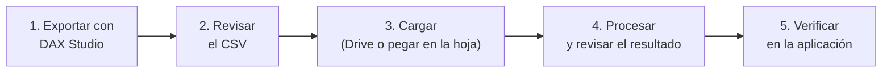

# Guía rápida del ETL de SIGECO

Cómo llevar la deuda desde Power BI hasta la aplicación web. Sirve para las dos instancias; donde difieren, se indica.

## Antes de empezar

- Rol **Administrador** en la aplicación. Para el ETL de pagos basta el rol Supervisor.
- La tabla de Power BI actualizada al corte que se quiere cargar.
- Nada de esto se sube a GitHub: ni el CSV ni capturas con datos reales.

## 1. Exportar con DAX Studio

1. Abrir el archivo `.pbix` y, desde DAX Studio, conectarse al modelo.
2. Ejecutar una consulta que devuelva la tabla de la instancia y exportarla a **CSV** (UTF-8).
3. Dejar los nombres de columna como salen de Power BI. El ETL quita el prefijo «Suma de», pasa a mayúsculas y elimina tildes y espacios.

| Instancia | Columnas mínimas |
|---|---|
| Patente Municipal | `RUC` y, para el detalle, `ANIOSOLICITUD`, `IMPUESTO`, `NOMBRECONTRIBUYENTE`, `TIPOPERSONA`, correos, teléfonos, `REPRESENTANTELEGAL`, `SUMVALORIMPUESTO`, `SUMVALORINTERES`, `SUMVALORMULTA`, `SUMVALORRECARGO`, `SUMVALORPENDIENTE` |
| Bahías | `RUC` o `IDENTIFICACION`, `NOMBRE_CONTRIBUYENTE` o `COMERCIANTE`, `NO_DE_PUESTO`, `TIPO_IMPUESTO` o `TIPO_DE_RUBRO`, `PERIODO_DESDE`, `PERIODO_HASTA`. Opcionales: mercado, asociación, giro, correos, teléfonos, deuda y código CEP |
| Pagos (ambas) | `RUC`, `MONTO_PAGADO`. Opcionales: `TIPO_PAGO` (`ABONO`, `PAGO_TOTAL`, `CUOTA_CONVENIO`), `REFERENCIA`, `FECHA_PAGO` (`AAAA-MM-DD`) |

## 2. Revisar el CSV

- Que el RUC o la cédula tenga 10 o 13 dígitos. En Bahías, si falta, el sistema genera un identificador interno `SINID-…` y lo reporta.
- Que los importes usen un solo formato decimal. El ETL acepta coma o punto.
- Que no haya filas repetidas con valores distintos para la misma obligación.

## 3. Cargar

**Patente Municipal**

- *Por Drive (recomendado):* subir el CSV a `SIGECO_ETL/IMPORTS`. El disparador de las 6:00 lo procesa y lo mueve a `SIGECO_ETL/PROCESSED` con la fecha en el nombre. Para procesarlo ya, ejecutar `importCSVFromDrive` en el editor de Apps Script. Esta vía **reemplaza** el contenido de `CONTRIBUYENTES`: el CSV debe ser el corte completo.
- *Pegando en la hoja:* crear `DATA_POWERBI_IMPORT_CONTRIBUYENTES` con el botón de configuración, pegar los datos y pulsar **Procesar Contribuyentes ETL**. Solo agrega las combinaciones RUC + impuesto + año que no existían.

**Bahías**

1. En la aplicación, crear la hoja `DATA_IMPORT_CONTRIBUYENTES` con el botón de configuración (una sola vez).
2. Pegar la tabla con sus encabezados originales.
3. Pulsar el botón del ETL de contribuyentes. Aparece la **vista previa**: filas, aceptadas, duplicadas, rechazadas y contribuyentes distintos.
4. Si es correcta, confirmar. El sistema hace un respaldo en `SIGECO_BACKUPS`, agrega o actualiza las obligaciones y crea y asigna los expedientes.

**Pagos (ambas):** pegar la tabla en `DATA_POWERBI_IMPORT_PAGOS` (se crea con el botón de configuración) y pulsar **Procesar Pagos ETL**. Cada pago se registra en el expediente activo del RUC; los RUC sin expediente activo quedan omitidos en el detalle.

## 4. Revisar el resultado

| Dónde | Qué mirar |
|---|---|
| Mensaje de la aplicación | Expedientes creados, omitidos y con error |
| Hoja `IMPORT_REPORTE` (Bahías) | Filas rechazadas, duplicadas, en conflicto o con identidad generada |
| Hoja `BITACORA` | Registro de la carga |
| Carpeta `PROCESSED` (Patente Municipal) | Que el CSV se haya movido; si sigue en `IMPORTS`, falló |

## 5. Verificar en la aplicación

Comparar contra Power BI el número de contribuyentes y el total de la deuda en el tablero. Si no cuadran, no continuar con la asignación hasta revisar el reporte.

## Problemas frecuentes

| Mensaje | Causa y solución |
|---|---|
| «Falta la columna requerida: …» | Cambió el nombre de una columna en Power BI. Corregir el encabezado |
| «La hoja staging cambió después de la vista previa» | Alguien editó la hoja entre la vista previa y la confirmación. Repetir la vista previa |
| «Existen claves duplicadas con datos incompatibles» | La misma obligación aparece con valores distintos. Depurar en Power BI |
| «Existe otra importación en curso» | Hay otra carga ejecutándose. Esperar unos minutos |
| «Archivo vacío o sin filas de datos» | El CSV no tiene filas o el delimitador no se reconoció (se aceptan coma y punto y coma) |
| «Sin gestores activos» | Crear antes usuarios con rol Gestor |

## Si algo sale mal

- **Bahías:** abrir el respaldo previo de `SIGECO_BACKUPS` (su nombre lleva la fecha y los primeros caracteres de la suma de verificación) y restaurar las hojas afectadas.
- **Patente Municipal:** restaurar desde el respaldo diario de las 2:00.
