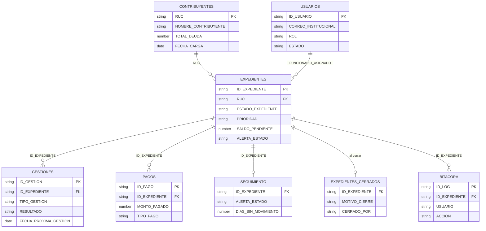

# Modelo de datos de SIGECO

Describe **solo la estructura** (hojas y columnas) de la base de cada instancia, que vive en una hoja de cálculo de Google Sheets. No incluye datos. Las columnas marcadas con 🔒 contienen datos personales o de seguridad en la base real.

## Hojas comunes a las dos instancias

| Hoja | Para qué sirve | Columnas principales |
|---|---|---|
| `CONFIG` | Parámetros del sistema | `CLAVE`, `VALOR`, `DESCRIPCION`, `ACTIVO` |
| `USUARIOS` | Cuentas y roles | `ID_USUARIO`, `NOMBRE`🔒, `CORREO_INSTITUCIONAL`🔒, `ROL`, `AREA`, `ESTADO`, `ACTIVO`, `FECHA_CREACION`, `ULTIMO_ACCESO`, `PASSWORD_HASH`🔒, `PASSWORD_SALT`🔒 |
| `CONTRIBUYENTES` | Padrón de deudores cargado desde la fuente | `RUC`🔒, `NOMBRE_CONTRIBUYENTE`🔒, correo y teléfonos de gestión🔒, `TOTAL_DEUDA`, `FECHA_CARGA` |
| `EXPEDIENTES` | Un expediente de cobranza por contribuyente | `ID_EXPEDIENTE`, `CODIGO_INTERNO`, `RUC`🔒, `TIPO_OBLIGACION`, `ESTADO_EXPEDIENTE`, `PRIORIDAD`, `FUNCIONARIO_ASIGNADO`, fechas de asignación y gestión, `DIAS_SIN_MOVIMIENTO`, `ALERTA_ESTADO`, valores (`VALOR_IMPUESTO`, `VALOR_INTERES`, `VALOR_MULTA`, `VALOR_RECARGO`, `TOTAL_DEUDA`), `MONTO_PAGADO`, `SALDO_PENDIENTE`, `PORCENTAJE_RECUPERADO`, `FECHA_ULTIMO_PAGO` |
| `GESTIONES` | Cada contacto o acción de cobro sobre un expediente | `ID_GESTION`, `FECHA_REGISTRO`, `ID_EXPEDIENTE`, `FUNCIONARIO`, `TIPO_GESTION`, `RESULTADO`, `OBSERVACION`, `FECHA_PROXIMA_GESTION`, `ESTADO_POST_GESTION`, `MONTO_RECAUDADO`, `USUARIO_EDITOR`, `TIMESTAMP` |
| `PAGOS` | Pagos aplicados a expedientes | `ID_PAGO`, `FECHA_PAGO`, `ID_EXPEDIENTE`, `RUC`🔒, `MONTO_PAGADO`, `TIPO_PAGO`, `REFERENCIA`, `REGISTRADO_POR`, `FUENTE`, `TIMESTAMP` |
| `SEGUIMIENTO` | Vista de alertas por expediente | `CATEGORIA`, `ID_EXPEDIENTE`, `CONTRIBUYENTE`🔒, `FUNCIONARIO`, `ESTADO_EXPEDIENTE`, `PRIORIDAD`, `DIAS_SIN_MOVIMIENTO`, `FECHA_PROXIMA_GESTION`, `ALERTA_ESTADO`, `FECHA_ACTUALIZACION` |
| `EXPEDIENTES_CERRADOS` | Archivo de expedientes cerrados | Las columnas de `EXPEDIENTES` más `FECHA_CIERRE`, `MOTIVO_CIERRE`, `CERRADO_POR`, `OBSERVACION_CIERRE` |
| `BITACORA` | Auditoría de cambios | `ID_LOG`, `FECHA_HORA`, `USUARIO`, `ROL`, `HOJA`, `ID_EXPEDIENTE`, `ACCION`, `CAMPO`, `VALOR_ANTERIOR`, `VALOR_NUEVO`, `CONTEXTO`, `ORIGEN` |
| `DASHBOARD` | Indicadores calculados por el sistema | indicador, `VALOR`, `DESCRIPCION`, `FECHA_CALCULO` |

## Diferencias por instancia

### Bahías
- `CONTRIBUYENTES` y `EXPEDIENTES` agregan datos del puesto comercial: `CATEGORIA_TIPO_MERCADO`, `MERCADO_SECTOR`, `ASOCIACION`, `NO_DE_PUESTO`, `GIRO_DEL_NEGOCIO`, `ESTADO_COMERCIANTE`, `PERIODO_DESDE`, `PERIODO_HASTA`, `ESTADO_DE_DEUDA`, `TOTAL_POR_COBRAR`, `CODIGO_CEP`.
- `USUARIOS` agrega `REQUIERE_CAMBIO_PASSWORD`.
- Hojas de preparación (*staging*) del ETL: `DATA_IMPORT_CONTRIBUYENTES` (formato de BASE BAHIA, con sus encabezados originales) e `IMPORT_REPORTE` (control de cada importación: fecha, checksum, tipo, fila de origen).
- `DATA_POWERBI_IMPORT_PAGOS` (`RUC`, `MONTO_PAGADO`, `TIPO_PAGO`, `REFERENCIA`, `FECHA_PAGO`) para el ETL de pagos.

### Patente Municipal
- `CONTRIBUYENTES` se organiza por año de solicitud e impuesto: `AÑO_SOLICITUD`, `TIPO_IMPUESTO`, `TIPO_PERSONA`, `REPRESENTANTE_LEGAL`, valores de impuesto, interés, multa y recargo.
- Hojas de preparación (*staging*) del ETL, donde llega el CSV exportado de Power BI: `DATA_POWERBI_IMPORT`, `DATA_POWERBI_IMPORT_CONTRIBUYENTES` (15 columnas: `ANIOSOLICITUD`, `IMPUESTO`, `RUC`, nombre, tipo de persona, correos, teléfonos, representante legal y sumas de impuesto, interés, multa, recargo y pendiente) y `DATA_POWERBI_IMPORT_PAGOS` (`RUC`, `MONTO_PAGADO`, `TIPO_PAGO`, `REFERENCIA`, `FECHA_PAGO`).
- Carpetas de Drive del ETL: `SIGECO_ETL/IMPORTS` (CSV por procesar) y `SIGECO_ETL/PROCESSED` (CSV ya cargados, con fecha y hora en el nombre).

## Diagrama entidad-relación

